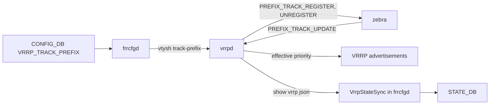
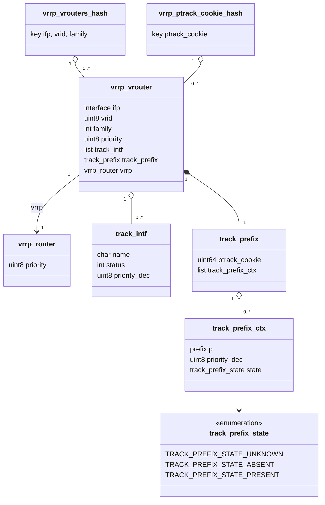

# VRRP Ptrack HLD

# Table of Contents
- [Revision](#revision)
- [About this Manual](#about-this-manual)
- [Definitions/Abbreviations](#definitionsabbreviations)
- [1 Requirements Overview](#1-requirements-overview)
  - [1.1 Functional requirements](#11-functional-requirements)
  - [1.2 Scalability](#12-scalability)
  - [1.3 Warm Restart requirements](#13-warm-restart-requirements)
- [2 Modules Design](#2-modules-design)
  - [2.1 Architecture](#21-architecture)
  - [2.2 Semantics](#22-semantics)
  - [2.3 Data structures](#23-data-structures)
  - [2.4 Cookie](#24-cookie)
  - [2.5 Zebra interaction](#25-zebra-interaction)
  - [2.8 Operational state](#28-operational-state)
  - [2.9 SONiC integration](#29-sonic-integration)
  - [2.10 gNMI](#210-gnmi)
- [3 Configuration](#3-configuration)
  - [3.1 FRR CLI](#31-frr-cli)
  - [3.2 FRR YANG](#32-frr-yang)
  - [3.3 CONFIG_DB](#33-config_db)
  - [3.4 STATE_DB](#34-state_db)
  - [3.5 SONiC CLI](#35-sonic-cli)

# Revision

| Rev | Date | Author | Change Description |
| - | - | - | - |
| 0.1 | Nov-20-2026 | Sriniketh J | Initial version |

# About this Manual

This document describes VRRP ptrack in FRR `vrrpd` and its SONiC integration. A VRRP group can track one or more IPv4 or IPv6 prefixes. When a tracked prefix is absent from the route table, the group's effective priority is decreased by a configured amount, and it is restored when the prefix is present again. This is complementary to the existing `interface tracking`. VRRP is a client of Zebra Ptrack (ptrack).

# Definitions/Abbreviations

| Term | Description |
| - | - |
| VRRP           | Virtual Router Redundancy Protocol |
| vrrpd          | FRR VRRP daemon |
| frrcfgd        | SONiC daemon that translates CONFIG_DB into FRR vtysh commands |
| ptrack         | Zebra Ptrack |
| Cookie         | 64-bit client-supplied value attached to a ptrack subscription. Opaque to zebra |
| VRRP instance  | A VRRP group, identified by (interface, VRID, address family) |
| Base priority  | The configured priority of the VRRP instance |
| Effective priority | The priority actually advertised and used in the election after further calculations |
| PRESENT        | Zebra reported the prefix REACHABLE |
| ABSENT         | Zebra reported the prefix UNREACHABLE |
| UNKNOWN        | No state from zebra yet |

# 1 Requirements Overview

## 1.1 Functional requirements

- Configure one or more tracked prefixes on a VRRP group, IPv4 and IPv6 groups, each with a priority decrement.
- Decrease the effective priority by the decrement of a tracked prefix when it becomes ABSENT, and increase it back when it becomes PRESENT.
- The effective priority never goes below `VRRP_PRIORITY_MINIMUM` (1) and never goes above the base priority.
- Ptrack coexists with interface tracking. Each tracker adjusts the same effective priority independently and additively.
- Configuring a prefix that is already tracked on the group updates its priority decrement, as `track-interface` does.
- Show the tracked prefixes in the VRRP show commands, and publish the tracking state to STATE_DB.
- Configuration through the SONiC CLI, CONFIG_DB and gNMI.

## 1.2 Scalability

No limit is added by vrrpd. The zebra limit applies: 16384 cookies per client per VRF, where every tracked prefix of every VRRP instance counts once.

## 1.3 Warm Restart requirements

- Zebra restart: zebra loses all ptrack state. On reconnect, vrrpd resets the state of all tracked prefixes to UNKNOWN and registers them again.
- vrrpd restart: the tracked prefixes are configured again from frr.conf, or by frrcfgd from CONFIG_DB, and they register as they are created. The state is UNKNOWN until zebra replies.

# 2 Modules Design

## 2.1 Architecture

No new process, container or database table in FRR. Tracking is inside `vrrpd` and talks to zebra over ZAPI. The SONiC side extends the existing VRRP configuration and state paths.



## 2.2 Semantics

- Matching is exact, as defined by zebra. A covering route does not satisfy a tracked prefix.
- The prefix is masked when it is stored, so `10.1.1.5/24` and `10.1.1.0/24` are the same prefix.
- The VRF is the VRF of the VRRP base interface, `vr->ifp->vrf->name`, as of now we don't support non-default vrf.
- Every tracked prefix is an independent tracker with its own state and its own decrement.

## 2.3 Data structures

`vrrp_vrouter`, `vrrp_router`, `track_intf` and `vrrp_vrouters_hash` exist today. `track_prefix`, `track_prefix_ctx`, `track_prefix_state` and `vrrp_ptrack_cookie_hash` are new.



- `vrrp_vrouter.priority` is the base priority. `vrrp_router.priority` is the effective priority.
- `track_prefix` holds all the ptrack data of one VRRP instance: the cookie and the tracked prefixes. Each `track_prefix_ctx` is one tracked prefix, with its own decrement and state.
- `vrrp_ptrack_cookie_hash` holds pointers only and owns no memory.

## 2.4 Cookie

One cookie per VRRP instance, shared by all its tracked prefixes. Zebra gives back the prefix with the cookie, so the cookie only has to identify the instance.

- Value: a 64-bit hash of the interface name, VRID, address family and VRF id of the instance. The primary address is not used, it can change or be empty.
- It is computed once, when the first tracked prefix of the instance is created, and stored in `track_prefix.ptrack_cookie`.
- `vrrp_ptrack_cookie_hash` maps the cookie to the instance. It is used to decode an UPDATE, because the hash cannot be reversed. The tracked prefix inside the instance is found by the masked prefix.
- If another instance already has the same cookie, it is hashed again until it is free.
- When the instance is destroyed, its cookie is removed from the hash.

## 2.5 Zebra interaction

Uses the ZAPI messages which are encoded and decoded with `zapi_ptrack_encode` and `zapi_ptrack_decode`.

- **REGISTER**: sent per tracked prefix when it is configured.
- **UNREGISTER**: sent when the tracked prefix is removed and when the VRRP instance is destroyed.
- **UPDATE**: the cookie finds the instance, the masked prefix finds the tracked prefix, and the state is applied. An unknown cookie or prefix is ignored. A state equal to the stored one is ignored.

## 2.8 Operational state

`show vrrp` and `show vrrp6` display the configured state. `show vrrp json` and `show vrrp6 json` display the operational state.

```
 Priority                                100
 Effective Priority (v4)                 70
 Tracking prefix                         2
 ..................................      10.0.0.0/24  vrf default  priority-dec:30
 ..................................      0.0.0.0/0    vrf default  priority-dec:20
```

## 2.9 SONiC integration

- **frrcfgd**: new handlers for `VRRP_TRACK_PREFIX` and `VRRP6_TRACK_PREFIX`, which push the track-prefix vtysh commands. They follow the existing `vrrp_track_handler`.
- **VrrpStateSync**: it already reads `show vrrp json` and `show vrrp6 json` and publishes `effective_priority` and `state` per instance. It is extended to publish one row per tracked prefix (see [3.4](#34-state_db)). Rows of removed prefixes are deleted.
- **sonic-utilities**: config commands for the tracked prefixes, and the show output.
- **sonic-yang-models**: new CONFIG_DB lists.

## 2.10 gNMI

GET and SET of the tracked prefixes and the operational state are added to the VRRP transformer (`xfmr_vrrp.go`) and its OpenConfig extension model. The paths and leaf names are defined in a later revision of this document.

# 3 Configuration

## 3.1 FRR CLI

At the same level as `track-interface`, in the interface node:

```
vrrp <1-255> track-prefix <A.B.C.D/M|X:X::X:X/M> priority-dec <10-50>
no vrrp <1-255> track-prefix <A.B.C.D/M|X:X::X:X/M>
vrrp6 <1-255> track-prefix <A.B.C.D/M|X:X::X:X/M> priority-dec <10-50>
no vrrp6 <1-255> track-prefix <A.B.C.D/M|X:X::X:X/M>
```

## 3.2 FRR YANG

In `frr-vrrpd.yang`, in the `vrrp-group` and `vrrp6-group`, adjacent to `track-interface`:

```
list track-prefix {
  key "prefix";

  leaf prefix { type inet:ip-prefix; }
  leaf priority-decrement { type uint8 { range "10..50"; } default "20"; }
}
```

## 3.3 CONFIG_DB

| Table | Key | Field |
| - | - | - |
| `VRRP_TRACK_PREFIX`  | `<ifname>\|<vrid>\|<prefix>` | `priority_decrement` (10..50) |
| `VRRP6_TRACK_PREFIX` | `<ifname>\|<vrid>\|<prefix>` | `priority_decrement` (10..50) |

## 3.4 STATE_DB

| Table | Key | Fields |
| - | - | - |
| `VRRP_TRACK_PREFIX_STATE_TABLE`  | `<ifname>\|<vrid>\|<prefix>` | `vrf`, `priority_decrement`, `state` |
| `VRRP6_TRACK_PREFIX_STATE_TABLE` | `<ifname>\|<vrid>\|<prefix>` | `vrf`, `priority_decrement`, `state` |

## 3.5 SONiC CLI

```
config interface vrrp track_prefix add <ifname> <vrid> <prefix> <priority_decrement>
config interface vrrp track_prefix remove <ifname> <vrid> <prefix>
```
Similarly for VRRP6
